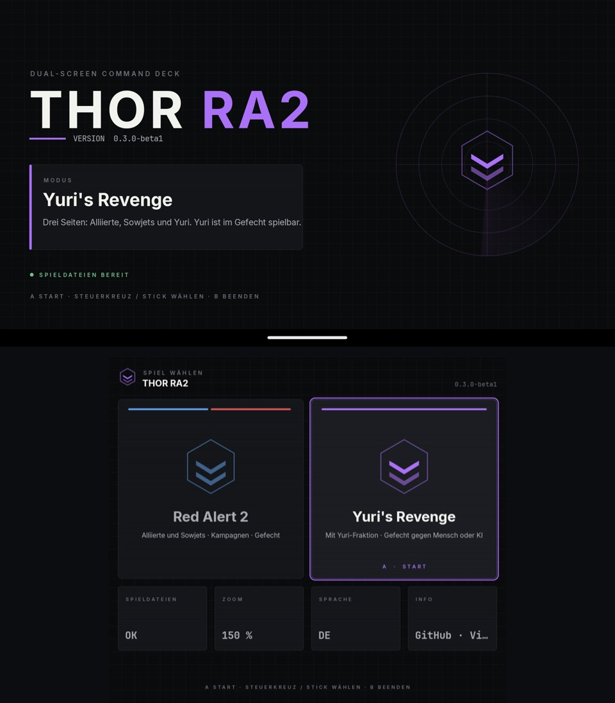
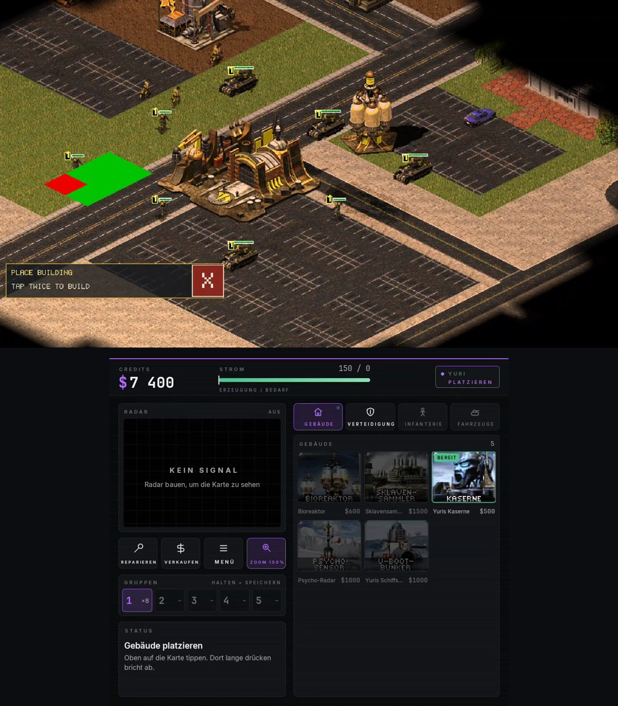
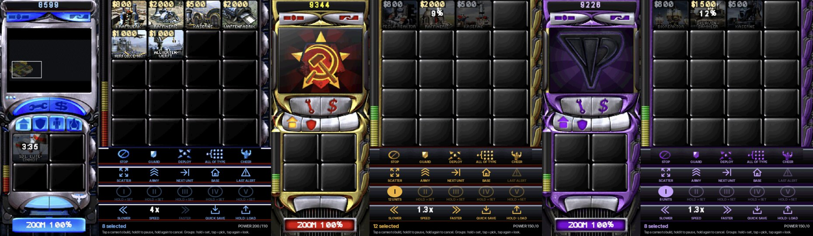

# Thor RA2

**Red Alert 2 / Yuri's Revenge on the AYN Thor, native, with a command deck on the second screen.**

> Not affiliated with, endorsed by or sponsored by Electronic Arts. No game data included: you need your own copy of Red Alert 2 with Yuri's Revenge.

▶ **[Update video: 0.4.0](https://youtu.be/BBisMbSHoLw)** · **[Watch the install guide](https://youtu.be/hMupGiEim60)** (3 min) · **[Showcase video](https://youtu.be/DOWgL-C954M)** · **[0.3.0 Yuri update](https://youtu.be/Or8qxMfXrh4)**

| Launcher (top + bottom screen) | Playing Yuri | The deck: your side's own sidebar |
|---|---|---|
|  |  |  |

<sub>Real screenshots from an AYN Thor. The sidebar art, font and cameos on the deck come from the player's own game files at runtime (a German copy here).</sub>

Made a video about this? [Open an issue](../../issues/new) and I'll link it here.

**All Thor ports: [toravo.de/en/thor](https://toravo.de/en/thor/)**

## Quick start

1. **Install the APK.** Download `ThorRA2-v0.4.0.apk` from [Releases](../../releases) on the Thor. In Chrome tap **Download anyway**, open the file, the **Package installer** asks for permission: **Settings → Allow from this source**, go back (you land in the download list) and **tap the APK again**, then **Install**.
2. **Get your game files.** From your Red Alert 2 / Yuri's Revenge install (Steam: `steamapps/common/Command & Conquer Red Alert II`, or The First Decade / EA App) copy every `.mix` and `.csf` file, about 1 GB. Required: `ra2.mix`, `ra2md.mix`, `language.mix`, `multimd.mix`. Recommended: `langmd.mix`, `theme.mix`, `thememd.mix`, `maps01.mix`, `maps02.mix`, `mapsmd03.mix`, `expandmd01.mix`, the `movies*.mix` / `movmd03.mix` archives.
3. **Put them on the Thor** in a folder `Download/RA2` (USB file transfer or `adb push`).
4. **Start Thor RA2.** The launcher opens on both screens. Tap **Game files** → **Import or update game files**, open the `RA2` folder, **Use this folder → Allow**. The files are copied into the app's own folder (`Android/data/de.harmssi.thorra2/files/ra2/`). Then pick **Red Alert 2** or **Yuri's Revenge** on the bottom screen.

**Permissions:** none to grant. The import uses Android's folder picker (no storage permission). Internet / Wi-Fi state are only used for LAN and online multiplayer.

If it works for you, a ⭐ on GitHub helps – and [subscribing on YouTube](https://www.youtube.com/@toravomusic?sub_confirmation=1) helps me bring more ports to the Thor.

---

Thor RA2 is an Android (arm64) build of [RA2 Engine](https://github.com/omarelarab/ra2-engine) by Omar El Arab, with the Yuri faction from [RA2AndroidPort](https://github.com/shietgrupe-cpu13/RA2AndroidPort) by Bryle13 (shietgrupe-cpu13); an open-source engine for *Command & Conquer: Red Alert 2 – Yuri's Revenge*, made for the AYN Thor dual-screen handheld:

- **Top screen (1920×1080):** only the map. The sidebar is gone and the tactical view uses the full width. Menus, briefings and movies are unchanged.
- **Bottom screen (1240×1080):** a touch command deck that looks like the game's sidebar of your side (Allied blue, Soviet red and gold, Yuri purple), drawn with the sidebar art, the HUD font and the cameos from your own game files: credits, options and diplomacy buttons, the radar in its frame (tap or drag to move the camera), REPAIR / SELL, the four build tabs, a cameo strip four columns wide with the power bar, superweapon sockets with their clocks, the advanced command bar (stop, guard, deploy, all of type, cheer, scatter, whole army, next unit, base, last alert), control groups I to V, game speed, quick save / load and ZOOM.
- **Controller and touch** on the top screen. The upstream touch command column (CMD) is hidden while the deck is shown.

Without a second screen everything stays as in RA2 Engine (sidebar on the right).

> Thor RA2 ships **no game data**. It runs on the original files from your own copy of the game (Red Alert 2 with Yuri's Revenge, e.g. *The First Decade*, Origin / EA App or Steam). The sidebar art, the font, the cameos and the radar are rendered at runtime from those files; none of it is in the APK.

Status: **v0.4.0** (the deck in the game's own sidebar look with the command bar, speed and quick save; Yuri faction (beta)) (see [Known limitations](#known-limitations)).

---

## Features

| | |
|---|---|
| **Dual screen** | The deck is an Android `Presentation` on display 4 (`FLAG_NOT_FOCUSABLE`, so the controller stays with the game). Without a second screen, or with the intent extra `single=true`, the original sidebar is shown on the top screen. |
| **Engine-faithful** | Every deck action goes through the engine's normal sidebar path: a cameo tap runs the sidebar's cameo click (start, queue, hold, cancel, place), a tab tap is the tab button, REPAIR / SELL are the sidebar buttons, a radar tap centres the view like a radar click, the options button is the Esc key, the command bar buttons run the keyboard commands' own handlers (`StopObject`, `GuardObject`, `DeployObject`, `TypeSelect`, `CombatantSelect`, ...), speed is the Options page's Game Speed, quick save / load use the game's save and load. The deck never changes game state directly. |
| **Game look** | The deck is the sidebar of your side: `sidec01.mix` (Allies) or `sidec02.mix` (Soviets) from your `ra2.mix`, Yuri's purple version of the Soviet shapes with his radar logo from `ra2md.mix`, the command bar's own buttons, the HUD font `12metfnt.fnt`. All read at runtime; if a file is missing the same layout is drawn as plain steel plates. |
| **Build deck** | Tap = build, or place when READY (then tap the spot on the top screen, and again to build). Buildings: tap again while building = hold. Units: every tap queues one more (the count is on the cameo). Long-press = hold, then cancel. The build clock sweeps over the cameo, the cost is on it (red when you cannot afford it). 20 cameos fit without scrolling; drag for more. |
| **Command bar** | The game's advanced command bar with its own button art: **stop, guard, deploy, all of type, cheer**, plus **scatter, whole army** (all armed units on screen, tap again for the whole map), **next unit, base, last alert** (tap again for the one before). Order buttons are dimmed without a selection. |
| **Speed, save** | **Slower / faster** change the game speed live (0.7× to 4×, tap the number for 1×), like the slider on the Options page. **Quick save** writes one save slot, **hold LOAD** brings it back. Single player only. |
| **Radar** | In the sidebar's own radar frame: your side's logo without a radar, the art's power-up frames when it comes online, then the engine's radar picture (terrain, ore, shroud, buildings, units) with the camera frame. Tap or drag to scroll the map. |
| **Control groups** | Groups I–V as large buttons with their unit count. Hold = save the current selection as that group (`Ctrl`+`1`–`5`), tap = select it (the engine's `1`–`5` key), tap again = camera to the group. A group is filled while it is the whole selection. |
| **Zoom** | **ZOOM** on the deck cycles the game picture 100 % → 125 % → 150 % live, mid-game (bigger units and infantry, less map on screen). The engine just uses a smaller canvas and scales it to the top screen; touch, selection box, radar frame and group camera follow. The setting is kept. |
| **Superweapons** | Up to four sockets under the tabs: the cameo with the clock sweep and a countdown; tap when READY to pick a target on the top screen. |
| **Diplomacy** | The sidebar's second cap button opens the game's diplomacy page (the briefing in a campaign). |
| **Controller** | Left stick = cursor, A = left click, B = right click, right stick / D-pad = scroll, Start = options menu, Back = centre on base, X = deploy, Y = stop, L3 (hold) = force fire, **L2** = all of the selected type, **R2** = guard, **R3** = whole army. **L1 / R1** switch the deck's build tab. In the shell menus the **D-pad** jumps the cursor from button to button, A presses. |
| **Launcher** | Title screen on top, choice on the bottom screen: **Red Alert 2** (Allies and Soviets; Yuri hidden in the skirmish lobby) or **Yuri's Revenge** (Yuri playable for humans and the AI), Game files, ZOOM, language, info. Touch or controller (D-pad / stick, A start, B exit). The engine plays Yuri's Revenge rules in both modes. |
| **Languages** | Deck in English (default), Deutsch, Español, Français, following the system / per-app language. |

## Game data

Copy every `.mix` and `.csf` file from your Red Alert 2 install folder (the one with `ra2.mix`, about 1 GB) to

```
/sdcard/Android/data/de.harmssi.thorra2/files/ra2/
```

Required: `ra2.mix`, `ra2md.mix`, `language.mix`, `multimd.mix`. Recommended: `langmd.mix`, `theme.mix`, `thememd.mix`, `maps01.mix`, `maps02.mix`, `mapsmd03.mix`, patch and movie archives (see [README.upstream.md](README.upstream.md)).

Ways to get them there:

- **In the app:** if files are missing, the start screen offers **Import game files** (Storage Access Framework picker, no extra permissions).
- **Over adb:** `thor/copy-data.sh` copies the files from another folder on the device, for example from the upstream RA2 Engine app (`org.ra2.engine`) or `SRC=/sdcard/Download/RA2`. It only reads the source folder.

Uninstalling the app deletes its data folder. Updating it (`adb install -r`) does not.

## Building

Gradle builds everything: the engine (`libmain.so`, CMake + NDK r27c, SDL2 2.30.9 fetched by the upstream CMake) and the Java shell.

```sh
thor/build.sh            # → dist/ThorRA2.apk
thor/build.sh --install  # also adb install -r
```

`build.sh` syncs the tree to a Linux build host (`THOR_BUILD_HOST=user@host`, work directory `THOR_RA2_REMOTE`, default `/mnt/cache/thor-ra2`) and runs `thor/docker-build.sh` in the Docker image `thor-build` (build it once with `docker build -t thor-build thor/`, see `thor/Dockerfile`: Ubuntu 22.04, JDK 17, Android SDK 35, NDK 27.2.12479018, Gradle 8.9, CMake 3.31, Ninja).

The first build creates a signing key `<work>/keystore/thorra2.jks` with a random password in `thorra2.pass` next to it (both stay on the build host, never in the repository); keep them, so later builds install as updates.

### Layout

| Path | What |
|---|---|
| `engine/thor.{hpp,cpp}` | Engine side of the deck: command queue, snapshot, radar picture, cameo / name requests, JNI (`de.harmssi.thorra2.ThorBridge`) |
| `engine/thor_scene.inc` | `GameScene` members: runs deck commands through the sidebar and keyboard-command code, publishes the snapshot, decodes the side's sidebar art and the HUD font for the deck |
| `engine/pres_radar.inc` | Radar picture shared by the sidebar and the deck |
| `engine/platform.cpp` | Game controller (virtual mouse, scroll, buttons) |
| `engine/main.cpp`, `engine/touch_bar.inc` | Sidebar and touch column hidden in dual-screen mode (`sidebar_up_`, `thor::dual()`), hooks |
| `android/app/src/main/java/de/harmssi/thorra2/` | `ThorActivity` (game activity), `ThorScreens` (presentation on display 4), `ThorDeck` (the deck), `Ui` (design system) |
| `thor/` | Build scripts, Dockerfile, `copy-data.sh` |

Engine changes are small and marked `Thor RA2`; with `thor::dual()` false the engine behaves like upstream.

## Changelog

- **0.4.0**: the deck in the game's own look: your side's sidebar art, HUD font and command bar buttons read from your game files (Allied, Soviet, Yuri). New on it: the advanced command bar (stop, guard, deploy, all of type, cheer, scatter, whole army, next unit, base, last alert), game speed, quick save / load, the diplomacy button, superweapon sockets, a cameo strip four columns wide, bigger control groups I–V.
- **0.3.0**: **Yuri faction (beta)** in skirmish for human and computer players, with Psychic Dominator and Genetic Mutator; engine and gameplay work from [RA2AndroidPort](https://github.com/shietgrupe-cpu13/RA2AndroidPort) by Bryle13 (shietgrupe-cpu13), see [docs/YURI-THOR-INTEGRATION.md](docs/YURI-THOR-INTEGRATION.md). New launcher on both screens (Red Alert 2 / Yuri's Revenge). The camera stays inside the map (also with ZOOM). Deck in faction colors (Allies blue, Soviets red, Yuri violet). New game-files screen in EN/DE/ES/FR. Saves from 0.2.x do not load (they are kept).
- **0.2.1**: ZOOM button on the deck (100 / 125 / 150 %, live, saved); the importer now also copies `expandmd01.mix` (and other `expandmdNN.mix`).
- **0.2.0**: control groups 1–5 on the deck (tap / double tap / long-press, unit count); D-pad navigation in the shell menus; radar panel slightly smaller.
- **0.1.0**: first release.

## Known limitations

- The game is the RA2 Engine beta (0.9), see [README.upstream.md](README.upstream.md#known-limitations). Yuri is playable in skirmish only (no Yuri campaign); several Yuri abilities are still approximations or missing, see [docs/YURI-THOR-INTEGRATION.md](docs/YURI-THOR-INTEGRATION.md).
- Menu D-pad navigation jumps between the buttons, list entries and checkboxes; sliders (and some drop-down lists) still need the stick cursor. The in-game options menu uses the stick cursor.
- "Red Alert 2" in the launcher only hides Yuri in the skirmish lobby; the engine always plays Yuri's Revenge rules.
- Yuri faction is **beta**: Magnetron lift, Floating Disc drain, Chaos Drone berserk, Grinder / Bio Reactor specials and Yuri Prime building capture are approximations or missing; Psychic Dominator and Genetic Mutator play without their animations; Spy Plane and Force Shield are not there.
- The engine has no attack-move, waypoint mode or beacons in skirmish, so the deck has no buttons for them. Control groups are not part of a save: after a load they are empty.
- The deck's speed buttons and the Options page's Game Speed slider do not follow each other: the slider keeps its own value until you move it.
- Saves from 0.2.x do not load in 0.3.0 (save format changed); they are not deleted.
- Ares / Phobos overhaul mods such as Mental Omega do not run: they patch the original Windows game, this is a separate engine.
- The shell menu font has no ß; menus spell it "ss". Umlauts and accents are shown.
- Android 8.0 or later (arm64); made and tested for the AYN Thor.

## Credits & license

- **RA2 Engine** by Omar El Arab, [github.com/omarelarab/ra2-engine](https://github.com/omarelarab/ra2-engine), Zero-Clause BSD (0BSD), see [LICENSE](LICENSE) and [README.upstream.md](README.upstream.md)
- **Yuri faction and other engine work** from [RA2AndroidPort](https://github.com/shietgrupe-cpu13/RA2AndroidPort) (branch `android-touch`) by **Bryle13 (shietgrupe-cpu13)**, 0BSD, see [CREDITS.md](CREDITS.md). Its phone touch skins are in the tree but the Thor uses its own deck.
- Third-party components keep their own licences, see [NOTICE](NOTICE) and [THIRD_PARTY_NOTICES.md](THIRD_PARTY_NOTICES.md) (SDL2: zlib)
- Fonts: [Inter](https://rsms.me/inter/) and [JetBrains Mono](https://www.jetbrains.com/lp/mono/), SIL Open Font License 1.1 (`android/app/src/main/assets/licenses/`)
- The deck, its icons, the emblem and the app icon are original work. No EA / Westwood logos, fonts or artwork are included. Cameos and the radar are rendered at runtime from the player's own game files.
- Thor RA2's own changes are released under the same 0BSD licence.

**Trademark notice:** Command & Conquer, Red Alert and Yuri's Revenge are trademarks or registered trademarks of Electronic Arts Inc. This project is not affiliated with, endorsed by or sponsored by Electronic Arts. You need to own the game to use it.

---

## Deutsch

Thor RA2 bringt Red Alert 2 / Yuri's Revenge nativ auf den AYN Thor, auf Basis der quelloffenen RA2 Engine von Omar El Arab und der Yuri-Fraktion aus RA2AndroidPort von Bryle13 (shietgrupe-cpu13). Oben läuft nur die Karte über die volle Breite, ohne Seitenleiste. Unten liegt das Kommando-Deck im Aussehen der Seitenleiste der eigenen Seite (Alliierte, Sowjets, Yuri), gezeichnet mit der Leistengrafik, der Schrift und den Cameos aus den eigenen Spieldateien: Credits, Radar im Rahmen (Tippen oder Ziehen bewegt die Kamera), Reparieren / Verkaufen, vier Bau-Reiter, Strombalken, Superwaffen mit Uhr, Befehlsleiste (Stopp, Bewachen, Entfalten, alle des Typs, Jubeln, Verteilen, Armee, nächste Einheit, Basis, letzter Alarm), Gruppen I–V, Spieltempo, Schnellspeichern / Laden und ZOOM.

Jede Deck-Aktion läuft über den normalen Sidebar-Pfad der Engine, das Deck schreibt nie direkt in den Spielzustand. Tippen = bauen bzw. bei BEREIT platzieren (dann oben auf den Bauplatz tippen, zum Bauen noch einmal). Lange drücken = anhalten, dann abbrechen. L1 / R1 wechseln den Reiter. Ohne zweiten Bildschirm bleibt alles wie im Original.

**Controller:** linker Stick = Zeiger, A = Linksklick, B = Rechtsklick, rechter Stick / Steuerkreuz = Karte scrollen, Start = Optionsmenü, Back = zur Basis, X = Entfalten, Y = Stopp, L3 halten = Zwangsfeuer, L2 = alle des gewählten Typs, R2 = Bewachen, R3 = ganze Armee.

**Daten:** Alle `.mix`- und `.csf`-Dateien aus der eigenen Red-Alert-2-Installation (mit Yuri's Revenge) nach `/sdcard/Android/data/de.harmssi.thorra2/files/ra2/` kopieren, per Import im Startbildschirm oder mit `thor/copy-data.sh` über adb. Es werden keine Spieldaten mitgeliefert oder heruntergeladen.

**Neu in 0.4.0:** Das Deck sieht aus wie die Seitenleiste der eigenen Seite (Grafik, Schrift und Knöpfe werden zur Laufzeit aus den eigenen Spieldateien gelesen). Neu darauf: Befehlsleiste, Spieltempo, Schnellspeichern / Laden (LADEN halten), Diplomatie-Knopf, Superwaffen-Sockel, vier Cameo-Spalten, größere Gruppen I–V (halten = setzen, tippen = wählen, nochmal = hinsehen).

**Neu in 0.3.0:** Yuri-Fraktion (Beta) im Gefecht für Mensch und KI, mit Psychic Dominator und Genetic Mutator. Neuer Launcher auf beiden Bildschirmen (Red Alert 2 / Yuri's Revenge; die Engine spielt in beiden Modi die Yuri's-Revenge-Regeln). Die Kamera bleibt in der Karte, auch mit ZOOM. Deck in Fraktionsfarben, neuer Spieldateien-Bildschirm. Spielstände aus 0.2.x laden nicht mehr (sie bleiben erhalten).

**Bauen:** `thor/build.sh` (Docker-Image `thor-build` mit NDK 27.2, SDK 35, Gradle 8.9) erzeugt `dist/ThorRA2.apk`.

Command & Conquer, Red Alert und Yuri's Revenge sind Marken von Electronic Arts Inc. Dieses Projekt steht in keiner Verbindung zu Electronic Arts.

## Español

Thor RA2 lleva Red Alert 2 / Yuri's Revenge de forma nativa a la AYN Thor, basado en RA2 Engine. La pantalla superior muestra solo el mapa; la inferior es un panel de mando táctil con créditos, energía, radar, superarmas y construcción. Necesitas tu propia copia del juego: copia los archivos `.mix` y `.csf` a la carpeta indicada arriba.

**Novedades en 0.4.0:** el panel tiene el aspecto de la barra lateral de tu bando (el arte, la fuente y los botones se leen de tus propios archivos del juego). Nuevo: barra de órdenes (alto, guardia, desplegar, todos del tipo, vitorear, dispersar, ejército, siguiente unidad, base, última alerta), velocidad del juego, guardado rápido / cargar, botón de diplomacia, cuatro columnas de iconos, grupos I–V más grandes.

**Novedades en 0.3.0:** facción de Yuri (beta) en escaramuza para humanos e IA, con Dominador Psíquico y Mutador Genético; nuevo lanzador en ambas pantallas (Red Alert 2 / Yuri's Revenge); la cámara se queda dentro del mapa; panel en los colores de cada bando; nueva pantalla de archivos del juego. Las partidas guardadas de 0.2.x no se cargan (no se borran). Facción de Yuri: Bryle13 (shietgrupe-cpu13, RA2AndroidPort); motor: Omar El Arab.

## Français

Thor RA2 apporte Red Alert 2 / Yuri's Revenge en natif sur l'AYN Thor, basé sur RA2 Engine. L'écran du haut affiche uniquement la carte ; celui du bas est un panneau de commandement tactile avec crédits, énergie, radar, superarmes et construction. Il vous faut votre propre exemplaire du jeu : copiez les fichiers `.mix` et `.csf` dans le dossier indiqué ci-dessus.

**Nouveautés 0.4.0 :** le panneau a l'aspect de la barre latérale de votre camp (les graphismes, la police et les boutons sont lus dans vos propres fichiers du jeu). Nouveau : barre d'ordres (stop, garde, déployer, tous du type, acclamer, disperser, armée, unité suivante, base, dernière alerte), vitesse du jeu, sauvegarde rapide / chargement, bouton diplomatie, quatre colonnes d'icônes, groupes I–V plus grands.

**Nouveautés 0.3.0 :** faction Yuri (bêta) en escarmouche pour les joueurs et l'IA, avec le Dominateur psychique et le Mutateur génétique ; nouveau lanceur sur les deux écrans (Red Alert 2 / Yuri's Revenge) ; la caméra reste dans la carte ; panneau aux couleurs de chaque camp ; nouvel écran des fichiers du jeu. Les sauvegardes 0.2.x ne se chargent pas (elles sont conservées). Faction Yuri : Bryle13 (shietgrupe-cpu13, RA2AndroidPort) ; moteur : Omar El Arab.
