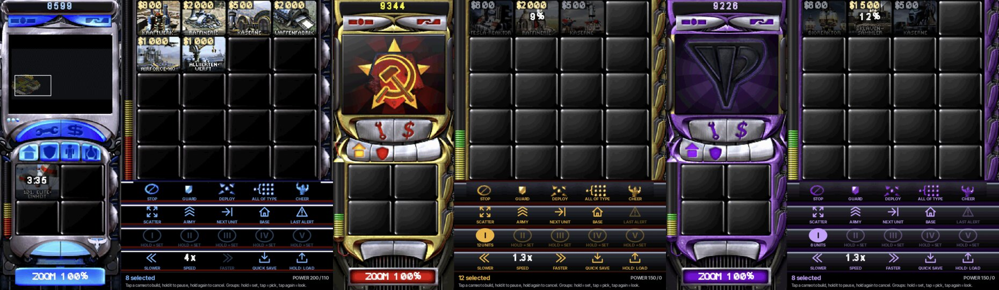

All Thor ports: [toravo.de/en/thor](https://toravo.de/en/thor/)

## Thor RA2 0.4.0: the deck is your side's own sidebar, with a command bar on it

### New on the bottom screen
- **Game look:** the deck is drawn with the game's own sidebar art from your files: the Allied, the Soviet or Yuri's sidebar with its credits strip, radar frame, repair / sell and tab buttons, cameo sockets and power bar, in the game's HUD font. Nothing of it is in the APK.
- **Command bar:** the game's advanced command bar with its own buttons: stop, guard, deploy, all of type, cheer. Next to them: scatter, whole army, next unit, base, last alert.
- **Control groups I to V,** larger: hold to store the selection, tap to pick it, tap again to look at it.
- **Game speed:** slower / faster, 0.7× to 4×, live; tap the number for 1×.
- **Quick save** and **hold LOAD** to bring it back (single player).
- **Diplomacy button** next to the options button (the briefing in a campaign).
- **Radar** in the sidebar's radar frame: your side's logo without a radar, the power-up animation when it comes online.
- **Superweapons** in four sockets under the tabs, with the clock sweep and the countdown.
- **Cameo strip** four columns wide: 20 cameos without scrolling, cost and queue count on the cameo.

### Controller
New: **L2** = all of the selected type, **R2** = guard, **R3** = whole army. Everything else as before (L1 / R1 switch the build tab).

### Tested on the Thor
Skirmish on Alamo as America, as Iraq and as Yuri (a German copy of the game): each side's sidebar art on the deck, building through the cameos with the clock, READY, hold and cancel, placing, the power bar, the radar coming online in its frame with the camera frame, the Paradrop socket counting down, all four tabs and L1 / R1, every button of the command bar except last alert's second step, groups I and II by holding, pick and look, slower / faster, quick save and hold LOAD, the diplomacy page, the options button, ZOOM.

Not tested on the device: firing a superweapon from its socket, the new L2 / R2 / R3 controller buttons, a campaign (briefing button), the deck without readable art (steel plates), scrolling a tab with more than 20 cameos.

### Updating
Install over 0.3.0, the game files and saves stay.

### Known limitations
- The engine has no attack-move, waypoint mode or beacons in skirmish, so the deck has no buttons for them. The diplomacy page shows the houses; alliances can only be changed in network games.
- Control groups are not part of a save: after a load they are empty.
- The deck's speed buttons and the Game Speed slider on the Options page do not follow each other.
- Yuri's sidebar is the Soviet art recoloured purple with his own radar logo (the game files this was made with have no separate Yuri sidebar set).
- Everything from 0.3.0 still applies: Yuri is beta and skirmish only, the game is the RA2 Engine beta.

`ThorRA2-v0.4.0.apk` · SHA-256 `caedb4dbe6152d9d722944a8bc29d6452709d7de35974fa6836ba930f5c166e2`
